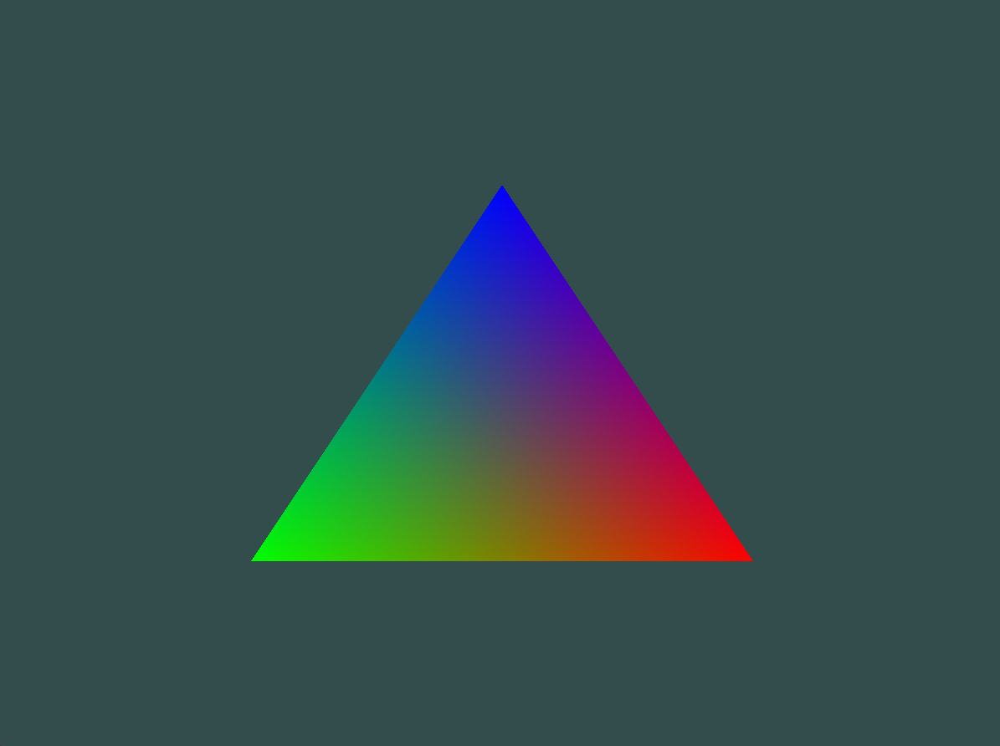
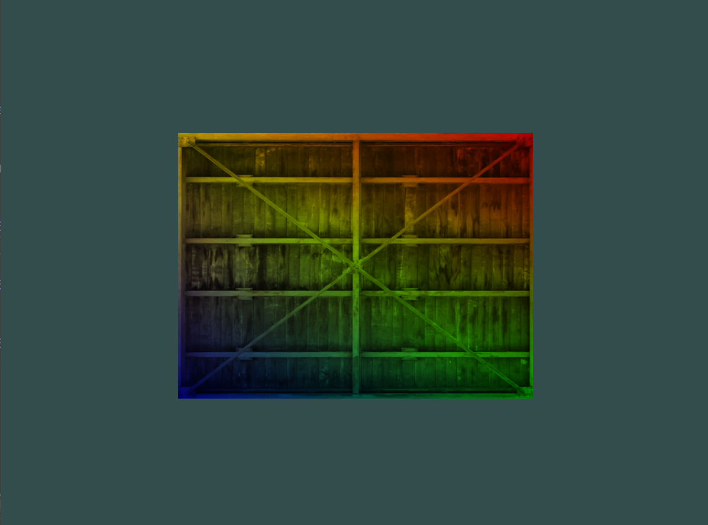
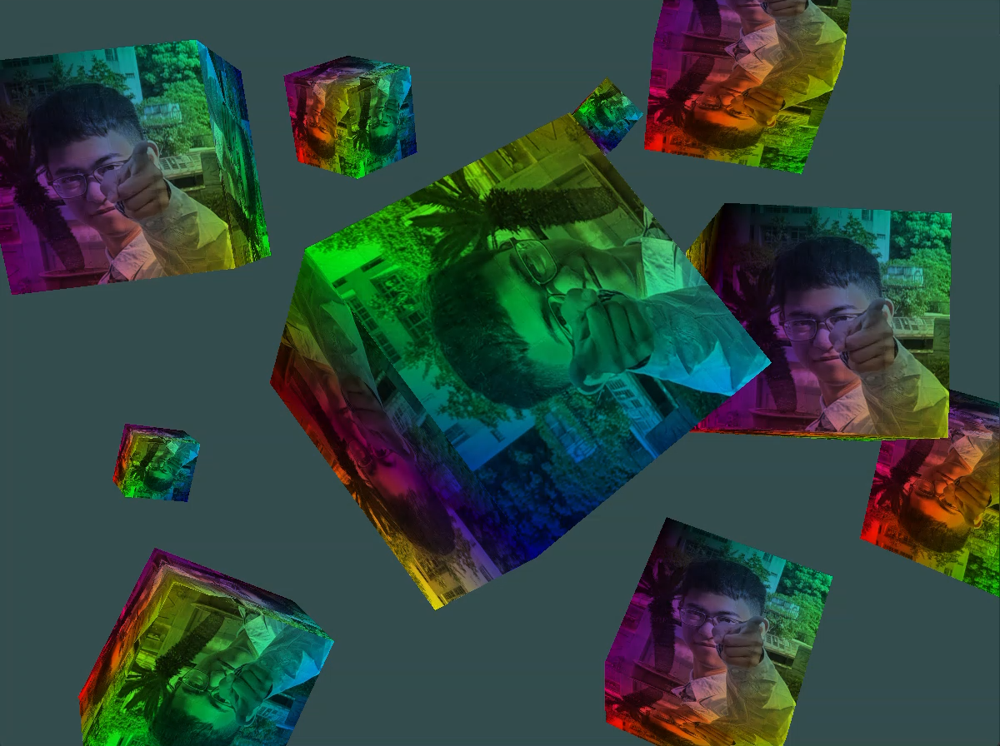
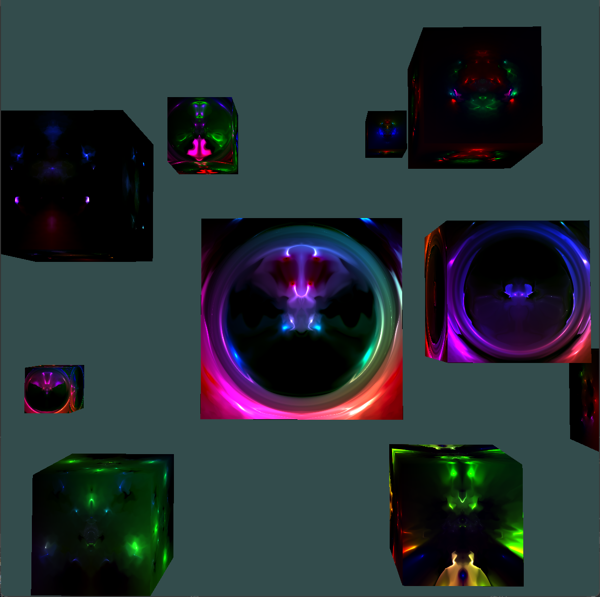
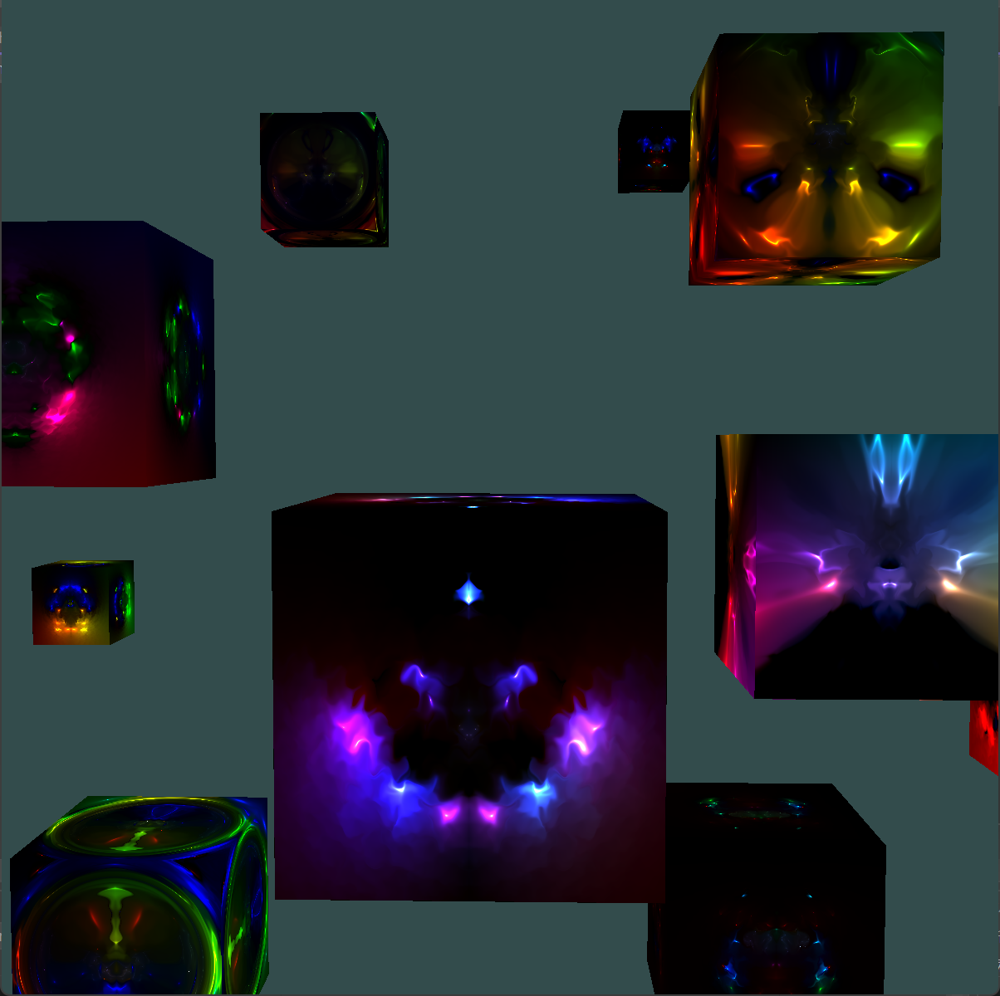
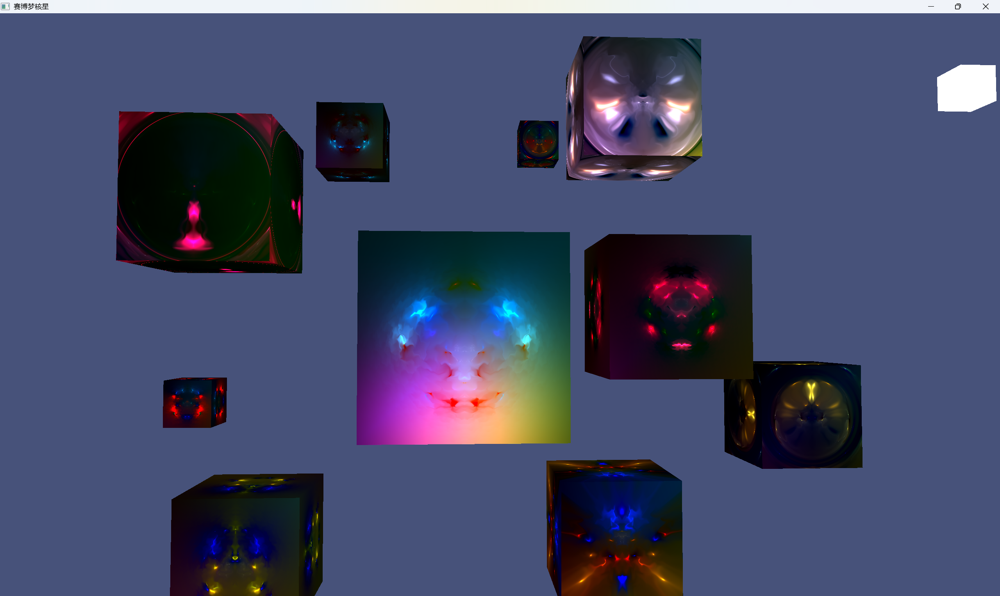
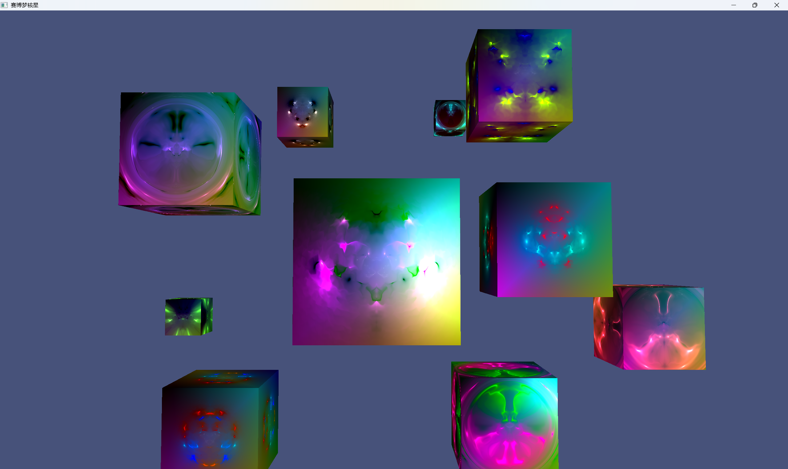
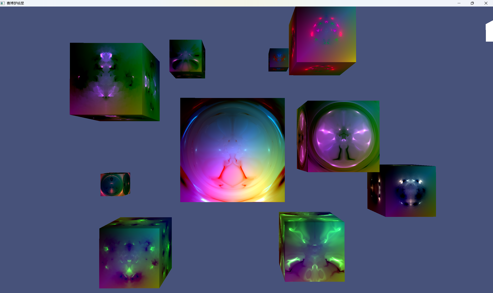
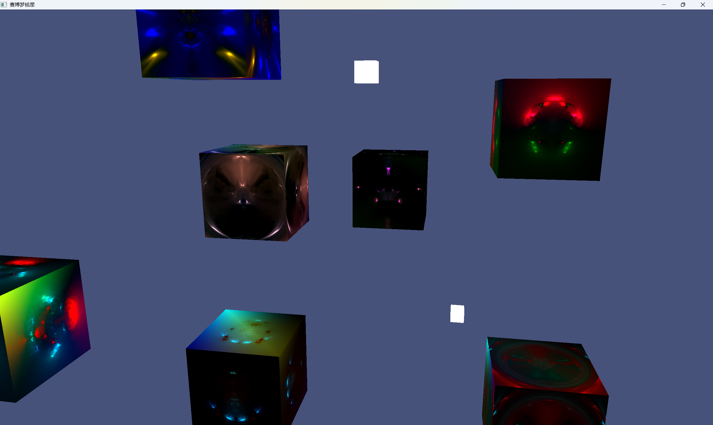

# OpenGL-demo
a demo for opengl learning

## Web version
The original C++ scene also runs in a browser through WebAssembly and WebGL 2. See [Web build instructions](web/README.md). Serve the repository root over HTTP and open `index.html`.

## Latest
### [纳米梦核星_哔哩哔哩_bilibili by AXeonV](https://www.bilibili.com/video/BV1S9bjzHE8W)

## Steps
0. Re
1. Shaders

2. Textures

3. Transformations
4. Coordinate Systems

5. Camera

6. Lighting

